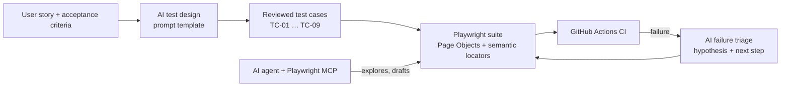

# 🤖 AI-Assisted QA Automation — Playwright + MCP + Copilot


A working portfolio project that shows **how AI is actually used in modern QA
automation** — not as a buzzword, but as three concrete, repeatable workflows
built around a real Playwright (TypeScript) test suite:

| AI workflow | Where it lives | What it does |
|---|---|---|
| **1. Agent-driven testing via MCP** | `.vscode/mcp.json`, `docs/mcp-with-playwright.md` | An AI agent (VS Code Copilot / Claude) drives the browser through Microsoft's Playwright MCP server, reading accessibility-tree snapshots and acting with semantic locators |
| **2. AI test design** | `ai/prompts/`, `ai/requirements/`, `ai/examples/` | A prompt template turns a user story + acceptance criteria into a structured test-case table; the reviewed output is implemented 1-to-1 in the automated suite |
| **3. Copilot-assisted engineering** | `fixtures/test-data.ts`, `ai/prompts/failure-triage.md` | Copilot generates bulk/varied test data and accelerates framework code; a failure-triage prompt turns CI failures into a root-cause hypothesis in under a minute |

## Why this matters

AI changes the QA workflow at the edges — design, data, exploration and
triage — while the committed test suite stays **deterministic**: no LLM
calls at test runtime, so CI is fast, repeatable and trustworthy. The
agent explores and drafts; the human reviews; the suite regresses.



## The test suite

- **App under test:** Playwright's public [TodoMVC demo](https://demo.playwright.dev/todomvc) — anyone can run this suite, no setup secrets.
- `tests/todo.spec.ts` — core regression (add / complete / filter / clear / persistence), case IDs traceable to `ai/examples/generated-test-cases.md`.
- `tests/ai-assisted/self-healing.spec.ts` — self-healing-friendly locator strategy in executable form, plus AI-generated bulk data under load.
- `tests/pages/TodoPage.ts` — Page Object using **only semantic locators** (role, label, placeholder, text). No XPath, no brittle CSS chains: the same vocabulary an MCP agent sees in the accessibility tree.

## Quick start

```bash
npm install
npx playwright install chromium
npm test            # headless run
npm run test:ui     # interactive UI mode
npm run report      # open the HTML report
```

## Try the MCP workflow yourself

1. Open the repo in VS Code and start the `playwright` server from `.vscode/mcp.json`.
2. In Copilot Chat → Agent mode, ask it to open the demo app, add two tasks and complete one.
3. Ask it to codify the flow as a Playwright test using the existing Page Object.
Full walkthrough: [`docs/mcp-with-playwright.md`](docs/mcp-with-playwright.md)

## Project structure

```
├── .vscode/mcp.json            # MCP servers: Playwright + GitHub
├── .github/workflows/          # CI: Playwright on every push / PR
├── ai/
│   ├── requirements/           # sample user story (input)
│   ├── prompts/                # test-design + failure-triage prompt templates
│   └── examples/               # reviewed AI-generated test cases
├── docs/mcp-with-playwright.md # MCP concepts, setup, MCP vs API
├── fixtures/test-data.ts       # incl. Copilot-generated bulk data
└── tests/                      # regression + AI-assisted pattern specs
```

## Roadmap

- [ ] Add an API test layer (Playwright `request` fixture) with AI-generated contract cases
- [ ] Record an MCP agent session and commit the generated spec as a worked example
- [ ] Visual regression with screenshot baselines + AI diff summary

## About

Built by **Isha Tiwari** — Senior QA Specialist / SDET with 14+ years in test
automation (Playwright, Selenium, Cypress, C#/.NET, Azure DevOps CI/CD, API
testing). This project documents the AI-assisted workflow I use in practice:
GitHub Copilot for framework development and test data, and MCP-connected
agents for exploration and test design.

📫 Connect on [LinkedIn](https://www.linkedin.com/in/isha-tiwari-b0245613b/)
